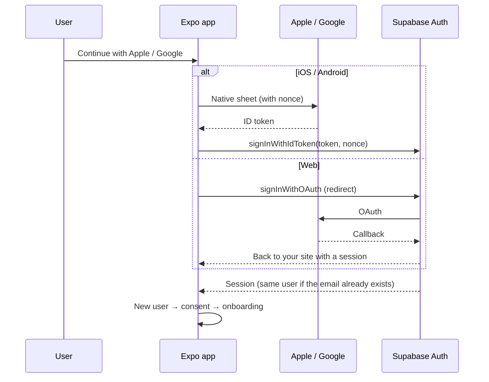

# Sign in with Apple + Google for Expo and Supabase

A complete, tested path to **Sign in with Apple** and **Sign in with Google** in an Expo (React Native) app that uses
**Supabase Auth**. It covers iOS, Android and the web build, and you can run it yourself or hand it to an AI coding
agent (Claude Code, Codex, Cursor, …).

It isn't a library. It's the playbook, the code templates and the check scripts from shipping this in a real
production app. That includes every console setting that silently breaks sign-in when it's wrong, the App Store
rules that get apps rejected, and the checks that prove each step worked.

| | iOS app | Android app | Web (react-native-web) |
|---|---|---|---|
| **Sign in with Apple** | Native sheet | – | Supabase redirect |
| **Sign in with Google** | Native sheet | Native account picker | Supabase redirect |

## What's covered
- **Console setup**:
  - Google Cloud: consent screen, plus web, Android (×2) and iOS clients.
  - Apple Developer: the App ID capability, the Sign in with Apple key, a Services ID for web, and email relay.
- **Supabase Auth config**: provider settings, client ID order, nonce and the redirect allow list, applied by a
  script.
- **App code**:
  - Native ID-token sign-in, including the nonce and the Apple name that's only sent once.
  - A web redirect flow, with the native module kept out of the web bundle.
  - Buttons that follow Apple's and Google's rules.
- **Consent**: social sign-ups skip your email form, so they get the consent step (GDPR, PDPA and so on) at the
  start of onboarding.
- **Account deletion**: revokes the user's Apple token, as App Store guideline 5.1.1(v) requires.
- **Web**: Apple's web client secret expires every 6 months, and a script renews it. Plus how to test on a preview
  deploy.
- **Shipping**:
  - The first build after enabling the capability.
  - Why an OTA update can crash older builds.
  - What App Review checks.
- **Troubleshooting**, indexed by symptom.

## How it works



## Use it with an AI agent (recommended)

**Claude Code:** install it once as a personal skill, then ask for it in any project.

```bash
git clone https://github.com/zemang86/expo-supabase-social-auth ~/.claude/skills/expo-supabase-social-auth
```

Then, inside your app's repo:

> Add Sign in with Apple and Google to this app.

**Codex, Cursor, Gemini and other agents:** clone the repo anywhere and point the agent at it.

> Add Sign in with Apple and Google to this app. Follow the playbook in `~/code/expo-supabase-social-auth/SKILL.md`
> and use its templates and scripts.

The agent does the code, the Supabase config and the checks. You do the console clicks it lists for you. It asks
before anything touches production.

## Do it by hand

Read the docs in order. Each one ends with a **Verify** section.

1. [How it works](docs/01-how-it-works.md)
2. [Google Cloud](docs/02-google-cloud.md)
3. [Apple Developer](docs/03-apple-developer.md)
4. [Supabase](docs/04-supabase.md)
5. [Expo app](docs/05-expo-app.md)
6. [Consent and onboarding](docs/06-consent-and-onboarding.md)
7. [Account deletion](docs/07-account-deletion.md)
8. [Web app](docs/08-web-app.md)
9. [Testing and verification](docs/09-testing-and-verification.md)
10. [Shipping builds](docs/10-shipping-builds.md)
11. [Troubleshooting](docs/11-troubleshooting.md)
- Appendix: [Auth emails with custom SMTP](docs/appendix-auth-emails.md)

## What's in the repo

```
SKILL.md        The agent playbook (also a Claude Code skill)
AGENTS.md       Entry point for any AI agent
docs/           The tutorial
templates/
  expo/         socialAuth.ts (native), socialAuth.web.ts (web), SocialSignIn.tsx, logo assets, app.config example
  supabase/     apple-signin.ts (token revocation) + test, a delete-account edge function
scripts/        Supabase config, Apple web secret, key / redirect / entitlement checks (Node 18+, no dependencies)
```

## Requirements
- An Expo app on SDK 54 or newer, built with EAS. Tested on SDK 57 with React Native's New Architecture.
  Expo Go can't run the native Google module, so test in a development or store build.
- Supabase Auth, with `@supabase/supabase-js` v2.
- An Apple Developer Program membership for Sign in with Apple, and a Google Cloud project (free).
- For Android: the app in Google Play Console, so it has an app-signing key.

## Time and cost
About a day: a couple of hours of console setup, then the code and checks. Google Cloud and Supabase cost nothing
for this. Sign in with Apple needs the paid Apple Developer membership you already need to ship an iOS app.

## Credits
Extracted from shipping [Damaura](https://damaura.ai), an Expo + Supabase app, by Hazman Hassan with Claude Code.
Issues and pull requests are welcome, especially when a console UI moves or a store rule changes.

## License
[MIT](LICENSE)
